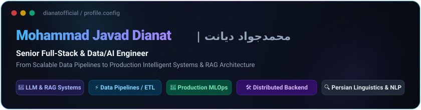
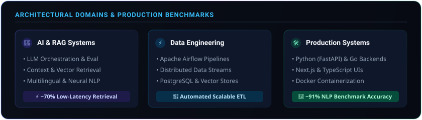

  

  
  
  

---

### 🛠️ Tech Stack & Ecosystem

<table align="center" width="100%">
  <tr>
    <td width="25%" valign="top"><b>Languages</b></td>
    <td width="75%">
      
      
      
      
      
    </td>
  </tr>
  <tr>
    <td width="25%" valign="top"><b>AI, RAG & NLP</b></td>
    <td width="75%">
      
      
      
      
      
    </td>
  </tr>
  <tr>
    <td width="25%" valign="top"><b>Data & MLOps</b></td>
    <td width="75%">
      
      
      
      
      
    </td>
  </tr>
  <tr>
    <td width="25%" valign="top"><b>Backend & Web</b></td>
    <td width="75%">
      
      
      
      
    </td>
  </tr>
</table>

---

### 🏛️ Engineering Blueprint & System Architecture

  

---

### 🚀 Core Engineering Highlights

- 🧠 **Production RAG & LLM Orchestration:** Architecting resilient semantic search and RAG systems with dense vector indexing, hybrid ranking, and prompt optimization (~70% low-latency retrieval boost).
- ⚡ **High-Availability Data Pipelines:** Authoring end-to-end Apache Airflow workflows and automated ETL pipelines with idempotent data transformation and schema observability.
- 🛠️ **Robust Distributed Backends:** Building decoupled microservices with Python (FastAPI), Go, and PostgreSQL, containerized with Docker for predictable production deployments.
- 🔍 **Persian Linguistics & NLP:** Domain-specialized Persian language processing, tokenization, named-entity recognition, and transformer fine-tuning achieving high benchmark precision.

---

### 🌟 Featured Projects

| Repository | Focus & Architecture | Domain |
| :--- | :--- | :--- |
| 🚀 [`chatbot-rag`](https://github.com/dianatofficial/chatbot-rag) | Production Retrieval-Augmented Generation (RAG) system with hybrid search | AI / LLM |
| ⚡ [`Data-Quality-and-Observability`](https://github.com/dianatofficial/Data-Quality-and-Observability) | Automated data quality assertions, pipeline telemetry & metrics validation | Data Engineering |
| 📊 [`Real-time-Clickstream-Anomaly-Detection`](https://github.com/dianatofficial/Real-time-Clickstream-Anomaly-Detection) | High-throughput distributed streaming data processing & anomaly detection | MLOps / Streaming |

---

### 🤝 Connect & Collaborate

  
  
  
  

